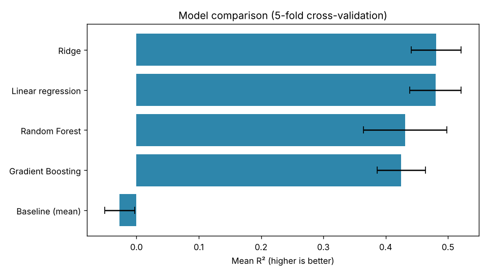

# Hi, I'm Jordi Blanch 👋

**IT Support · Service Desk · QA** · Software Engineering Student · Hybridge · Mexico

[](https://www.linkedin.com/in/jordi-contreras-blanch/)
[](mailto:paastor.blanch@gmail.com)
[](https://github.com/JordiBlanch666)


---

## About me

I'm not your typical software engineering student.

Before writing my first algorithm, I spent six years maintaining **zero-error metrics in live broadcast production** at K 102.7 FM — the closest real-world equivalent to a strict SLA. I designed **clinical decision algorithms in a hospital ICU** at San Jose Hospital, where documentation is non-negotiable and edge cases have consequences. At Charter Spectrum, I resolved 50+ tickets a day using Jira and Zendesk, with a 90% first-call resolution rate.

That background — broadcast ops, clinical QA, and enterprise tech support — is what brought me to Software Engineering. I'm formalizing what I already know about precision, documentation, and systems thinking into code.

This repository tracks that transition, term by term. My main project today is a private desktop app for clinical nutritionists (React + TypeScript, Python, SQLite, local AI) — see [my profile](https://github.com/JordiBlanch666).

---

## Repository structure

```
📦 algorithms-and-data-structures/
 ├── 📂 algorithms/
 │   ├── 📂 ordenamiento/        ← Bubble, Selection, Insertion sort
 │   ├── 📂 busqueda/            ← Linear & Binary search
 │   └── 📂 recursion/           ← Factorial & Fibonacci (with memoization)
 ├── 📂 data_structures/       ← Stack (LIFO) & Queue (FIFO)
 ├── 📂 fundamentals/             ← Functions, native data structures, file I/O
 ├── 📂 oop/                     ← OOP: the four pillars + banking system
 ├── 📂 networking/                   ← Networking: DNS, TCP, HTTP, port scanner
 ├── 📂 data-science/            ← Data science & machine learning (3rd term)  ⬅ new
 │   └── 📂 diabetes-progression/   ← EDA, model comparison, cross-validation
 ├── 📂 sql/                     ← SQL & databases (3rd term)  ⬅ new
 │   ├── 📂 sql-nutrition-clinic/    ← Nutrition clinic: BMI, progress, revenue
 │   ├── 📂 sql-help-desk-tickets/   ← Help Desk: SLA, MTTR, CSAT, backlog
 │   └── 📂 sql-streaming-analytics/ ← Streaming: MRR, churn, cohorts
 └── 📂 projects/
     ├── 📂 sonora_player/       ← Desktop music player with synced lyrics  ⬅ new
     ├── 📂 calculadora/         ← Calculator with history & memory  ⬅ new
     ├── 📂 todo_app/            ← To-Do app with priorities & JSON  ⬅ new
     ├── 📂 hangman/             ← Hangman game with ASCII art       ⬅ new
     ├── 📂 quiz/                ← Quiz app with timer & categories  ⬅ new
     └── 📂 gestor_calificaciones/ ← Grade Manager CLI
```

Run the full portfolio demo from the root:

```bash
python main.py
```

---

## Projects

### Sonora — Desktop Music Player
> [`projects/sonora_player`](projects/sonora_player)

Desktop music player built with **Tkinter**. Plays MP3, WAV, OGG, FLAC, AIFF and **AAC/M4A**
(iTunes purchases), with M3U playlists, search, shuffle and repeat, embedded cover art and
**synced lyrics** from local `.lrc` files or the LRCLIB public API.

```bash
cd projects/sonora_player
pip install -r requirements.txt
python main.py
```

| Concept | Where |
|---------|-------|
| Modular design: UI separated from testable logic | `sonora/player.py` vs. `audio.py`, `lyrics.py`, `metadata.py` |
| AAC decoding to WAV with PyAV (SDL_mixer can't play AAC) | `sonora/audio.py` |
| Synced lyrics with binary search (`bisect`) over LRC timestamps | `sonora/player.py`, `sonora/lyrics.py` |
| Background thread for HTTP requests without freezing the UI | `fetch_lyrics()` + `root.after()` |
| Graceful error handling (offline, corrupted files, DRM-protected `.m4p`) | throughout |
| Unit tests, including a real `.m4a` decode | `tests/test_sonora.py` |

### Calculator CLI
> `projects/calculator/calculator.py`

A command-line calculator with operation history, memory register, and safe expression parsing — no `eval()` used.

```bash
python projects/calculator/calculator.py
```

```
  calc › 125 * 8
  = 1000

  calc [M=1000] › 1000 / 3
  = 333.33333333

  calc › history
  #    Operation                      Result
  --------------------------------------------------
  1    125 * 8 = 1000
  2    1000 / 3 = 333.33333333
```

| Concept | Where |
|---------|-------|
| Input parsing | `parse_expression()` splits and validates tokens |
| Error handling | `ZeroDivisionError`, `ValueError` caught gracefully |
| State | history list + memory float persist across operations |
| No `eval()` | explicit `if/elif` per operator — safe and readable |

---

### To-Do App CLI
> `projects/todo_app/todo.py`

Task manager with three priority levels, status filters, and JSON persistence. Data survives between sessions.

```bash
python projects/todo_app/todo.py
```

```
  todo › add Fix binary search bug -p high
  ✓ Added [1] 'Fix binary search bug' (high)

  todo › add Read OOP chapter
  ✓ Added [2] 'Read OOP chapter' (medium)

  todo › list pending
  ID   St  Pri      Title                               Created
  ────────────────────────────────────────────────────────────────────
  1    ○   🔴 high  Fix binary search bug               2025-05-19 10:00
  2    ○   🟡 med   Read OOP chapter                    2025-05-19 10:01
```

| Concept | Where |
|---------|-------|
| CRUD | `add_task`, `complete_task`, `delete_task` |
| Filtering & sorting | `filter_tasks()` by status and priority |
| JSON persistence | `load_tasks` / `save_tasks` on every change |
| ID generation | `next_id()` — max existing ID + 1 |

---

### Hangman
> `projects/hangman/hangman.py`

Classic word-guessing game with ASCII art gallows, three difficulty levels, and a built-in word bank.

```bash
python projects/hangman/hangman.py
```

```
       -----
       |   |
       |   O
       |  /|
       |
       |
    --------

  Difficulty: MEDIUM  |  Wrong guesses left: 3

  p y _ _ _ _

  Wrong letters: a e i o s
```

| Concept | Where |
|---------|-------|
| Sets | `guessed` and `wrong` for O(1) membership checks |
| String masking | `masked_word()` replaces unguessed letters with `_` |
| Game loop | `play_round()` handles win/loss conditions |
| ASCII art | 7 gallows stages indexed by wrong-guess count |

---

### Quiz App CLI
> `projects/quiz/quiz.py`

Multiple-choice quiz on Python fundamentals and Networking basics. 15-second timer per question, speed bonus for answers under 5 seconds.

```bash
python projects/quiz/quiz.py
```

```
  Question 3/8   Score: 4   Time limit: 15s

  What is the time complexity of accessing an element in a Python list by index?

    [1] O(n)
    [2] O(log n)
    [3] O(1)
    [4] O(n²)

  Your answer (1-4): 3
  ✓ Correct! (+1 speed bonus!)  (2.3s)
  💡 Lists store elements in contiguous memory, so index access is always O(1).
```

| Concept | Where |
|---------|-------|
| Randomization | `random.sample()` shuffles questions each run |
| Timer | `time.time()` measures response time per question |
| Speed bonus | extra point for answering in under 5 seconds |
| Score grading | percentage → A/B/C/F with feedback message |

---

## Data Science — Third Term

### Diabetes Progression Prediction
> [`data-science/diabetes-progression`](data-science/diabetes-progression)

End-to-end data science project on **442 real diabetes patients** (Efron et al., 2004):
data validation, exploratory analysis, 5-fold cross-validated comparison of four models
against a baseline, hold-out evaluation and permutation importance.



| Result | Value |
|--------|-------|
| Strongest predictor | BMI (r = 0.59) |
| Obesity vs. normal weight | Average progression 213 vs. 109 |
| Best model | Ridge regression — R² 0.48 ± 0.04 (CV), 0.45 on unseen test data |
| Baseline (predict the mean) | R² −0.03 |

```bash
cd data-science/diabetes-progression
pip install -r requirements.txt
python main.py
```

**Stack:** pandas · scikit-learn · matplotlib · unittest

---

## SQL & Databases — Third Term

Three relational databases built in **SQLite**, each one with a normalized schema, constraints,
triggers, views, analytical queries and automated tests. No installation needed — Python includes SQLite.

| Project | Business question it answers | Highlights |
|---------|------------------------------|------------|
| [`sql/sql-nutrition-clinic`](sql/sql-nutrition-clinic) | Which patients are improving, who stopped coming, how much does the clinic bill per month? | 3NF schema, N:M relationship, validation trigger, `ROW_NUMBER`, `LAG`, `FIRST_VALUE` |
| [`sql/sql-help-desk-tickets`](sql/sql-help-desk-tickets) | Are we meeting the SLA? Which agent resolves fastest? What should we automate? | Audit-trail triggers, SLA view, `RANK`, moving averages, backlog aging |
| [`sql/sql-streaming-analytics`](sql/sql-streaming-analytics) | What is our MRR and churn? Do users keep watching after they sign up? | Recursive CTE calendar, partial unique index, cohort retention, simple recommender |

```bash
cd sql/sql-help-desk-tickets
python run.py                      # builds the database and runs every query
python run.py --list               # lists available queries
python -m unittest discover tests  # runs the tests
```

Each project has its own README with an ER diagram and sample results.

---

## OOP — Second Semester

Four pillars, four files, one integrating project.

| File | Concept | Demo |
|------|---------|------|
| `oop/01_classes_objects.py` | Classes & objects | Product catalog with VAT |
| `oop/02_encapsulation.py` | Encapsulation | Bank account with private attributes |
| `oop/03_inheritance.py` | Inheritance + `super()` | Animal → Dog / Cat / Parrot hierarchy |
| `oop/04_polymorphism.py` | Polymorphism + ABC | Geometric shapes with a common interface |

### Featured OOP Project — Banking System

```
Account (ABC)              ← abstract class, encapsulation
├── SavingsAccount         ← inheritance, applies interest
└── CheckingAccount        ← inheritance, overdraft limit
```

```bash
python oop/banking_system.py
```

| Concept | Where |
|---------|-------|
| Encapsulation | `__balance` only modified via `deposit` / `withdraw` |
| Inheritance | `SavingsAccount` and `CheckingAccount` extend `Account` |
| Polymorphism | `withdraw()` behaves differently in each subclass |
| Abstraction | `Account` is abstract — cannot be instantiated directly |
| `super()` | Child constructor delegates initialization to parent |
| `@property` | Read-only balance exposed cleanly |

---

## Networking Fundamentals — Second Semester

| File | Concept | What it does |
|------|---------|--------------|
| `networking/01_network_info.py` | DNS & IP addressing | Resolves hostnames, reverse lookup |
| `networking/02_tcp_client_server.py` | TCP sockets | Echo server + client over localhost |
| `networking/03_http_client.py` | HTTP protocol | Real GET requests, status codes, JSON API |
| `networking/04_port_scanner.py` | Ports & services | Concurrent scanner with thread pool |

---

## Algorithms — First Semester

### Sorting

| Algorithm       | Best case | Average  | Worst case | Space |
|-----------------|:---------:|:--------:|:----------:|:-----:|
| Bubble Sort     | O(n)      | O(n²)    | O(n²)      | O(1)  |
| Selection Sort  | O(n²)     | O(n²)    | O(n²)      | O(1)  |
| Insertion Sort  | O(n)      | O(n²)    | O(n²)      | O(1)  |

### Searching

| Algorithm     | Complexity | Requires sorted input |
|---------------|:----------:|:---------------------:|
| Linear Search | O(n)       | No                    |
| Binary Search | O(log n)   | Yes                   |

### Recursion

- **Factorial** — base case + recursive call, O(n) stack space vs O(1) iterative
- **Fibonacci** — naive O(2ⁿ) vs. memoized O(n) side by side

---

## Data Structures

| Structure | Type | Key operations     | Real-world demo              |
|-----------|------|--------------------|------------------------------|
| Stack     | LIFO | `push` / `pop`     | Balanced parentheses checker |
| Queue     | FIFO | `enqueue`/`dequeue`| Service queue simulation     |

---

## What I've learned

**Third term**
- Relational database design: normalization, primary/foreign keys, N:M relationships
- Constraints (`CHECK`, `UNIQUE`, partial indexes) and triggers for business rules
- Views, CTEs (including recursive) and window functions (`ROW_NUMBER`, `RANK`, `LAG`, `SUM OVER`)
- KPI analysis with SQL: SLA, MTTR, CSAT, MRR, churn, cohort retention
- Testing database logic with Python `unittest`
- Data science workflow: data validation, EDA, cross-validation, baseline comparison, model interpretation
- pandas, scikit-learn pipelines and matplotlib visualizations
- Desktop GUI with Tkinter, audio playback and decoding, threading for network calls

**Second semester**
- OOP: classes, encapsulation, inheritance, polymorphism
- Abstract base classes (`ABC`, `@abstractmethod`)
- Properties, dunder methods, class vs. instance attributes
- Designing with object hierarchies
- Networking: IP addressing, DNS, TCP sockets, HTTP, port scanning
- Concurrency: `ThreadPoolExecutor` for parallel I/O tasks
- CLI app design: REPL loops, input validation, JSON persistence, CRUD

**First semester**
- Time and space complexity analysis
- Sorting and searching algorithms from scratch
- Recursion and memoization
- Custom data structures (Stack, Queue)
- File persistence with JSON
- Version control with Git & GitHub

---

## Background

| Role               | Organization      | Relevant to SE                              |
|--------------------|-------------------|---------------------------------------------|
| QA / Broadcast Ops | K 102.7 FM        | Zero-error SLA, live system monitoring      |
| Clinical QA        | San Jose Hospital | Algorithm design, validation, documentation |
| Tech Support       | Charter Spectrum  | Jira/Zendesk, 50+ tickets/day, 90% FCR      |

---

> *I show up. I document everything. I don't break things.*
> Currently completing a Software Engineering degree at Hybridge · Certified in Git/GitHub & n8n automation.

---

**Jordi Yashua Contreras Blanch** · [paastor.blanch@gmail.com](mailto:paastor.blanch@gmail.com) · [github.com/JordiBlanch666](https://github.com/JordiBlanch666)

*Hybridge — Software Engineering · Third term · 2026*
