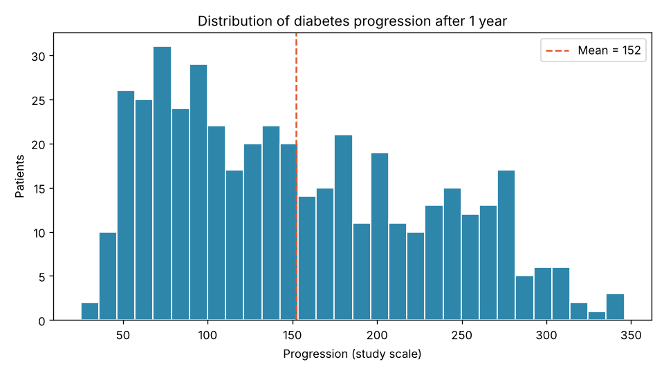
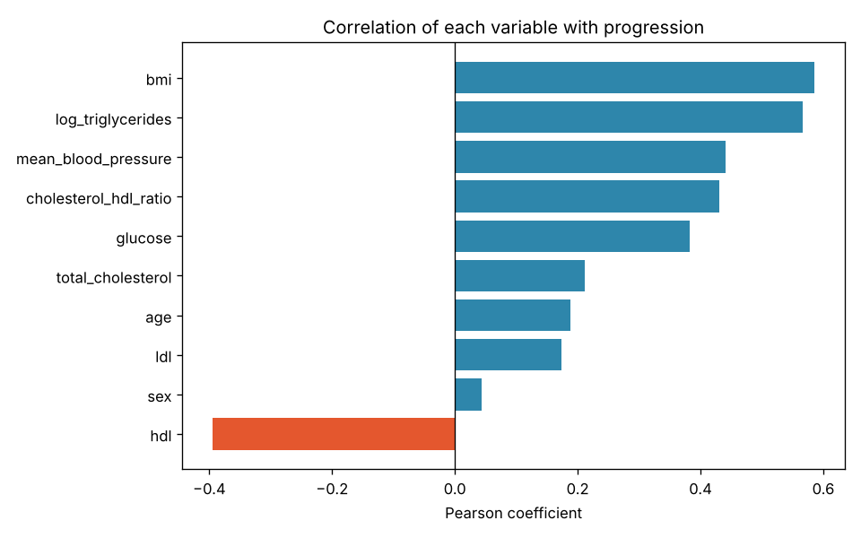
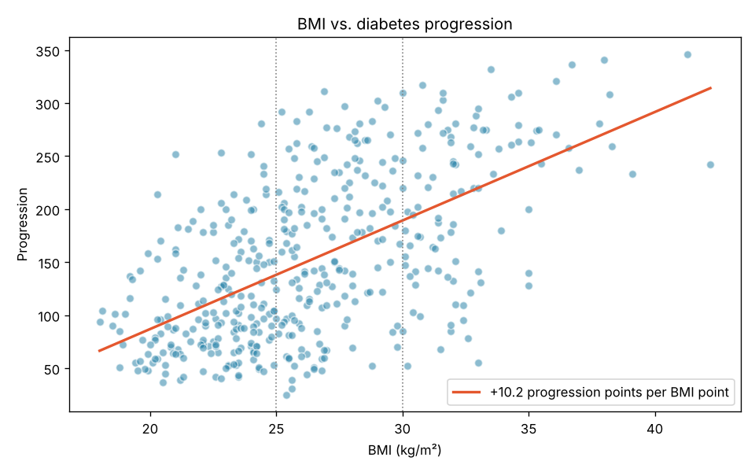
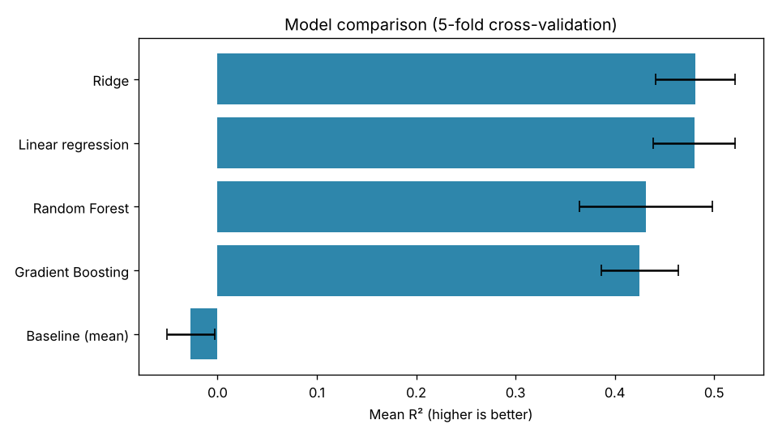
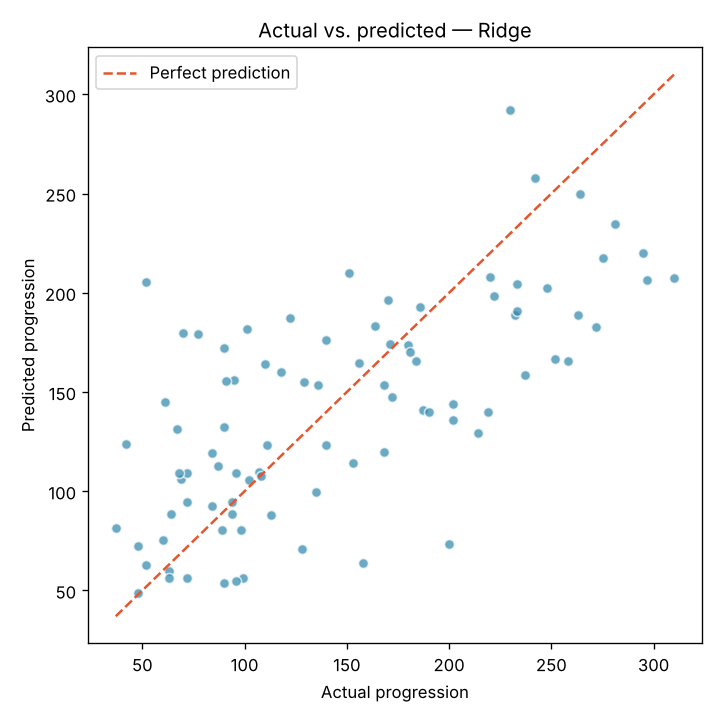
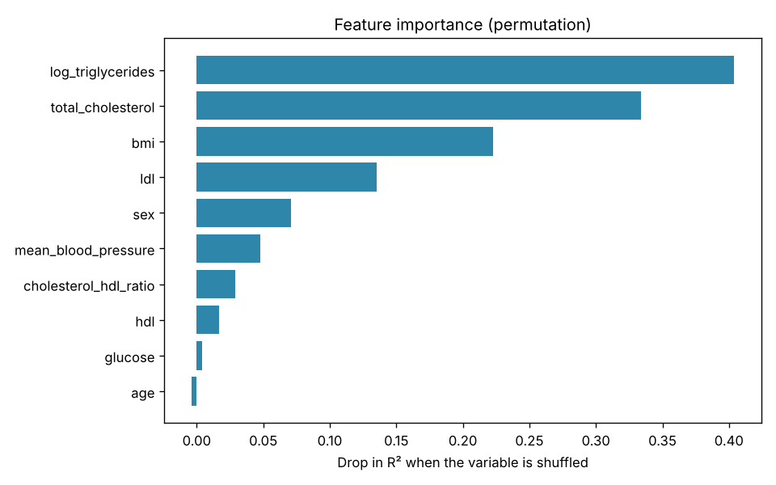

# 🩺 Diabetes Progression Prediction — Data Science with Python

An end-to-end data science project on **442 real diabetes patients**: data validation,
exploratory analysis, machine learning model comparison with cross-validation, evaluation on
unseen data and model interpretation.

**Question:** using a patient's baseline measurements (age, sex, BMI, blood pressure and six
blood tests), can we predict how much their diabetes will progress in one year, and which
variables matter most?

My background as a licensed nutritionist helped me interpret the clinical variables (BMI,
lipid profile, glucose) and check that the results made medical sense.

## 📊 Key results

| Finding | Value |
|---|---|
| Variable most correlated with progression | **BMI** (r = 0.59), followed by triglycerides (r = 0.57) |
| Patients with obesity vs. normal weight | Average progression **213 vs. 109** (almost double) |
| Best model | **Ridge** (regularized linear regression) |
| Cross-validated R² | **0.48 ± 0.04** (a baseline that predicts the mean scores −0.03) |
| Performance on the test set (89 unseen patients) | R² = **0.45**, mean absolute error = **42.8** points |

**Conclusions:**
- The linear models beat Random Forest and Gradient Boosting. With 442 patients and mostly
  linear relationships, a more complex model adds nothing and overfits more.
- Each additional BMI point is associated with **+10 points** of progression after one year.
- Total cholesterol and LDL look very important to the model, but they are highly correlated
  with each other (multicollinearity): the model uses them together, not separately. Their
  individual importance should not be read as a cause.
- An R² of 0.45 means the variables explain almost half of the variation. That's useful for
  flagging higher-risk patients, not for giving an exact individual prognosis.

## 🖼️ Charts

| | |
|---|---|
|  |  |
|  |  |
|  |  |

## 🧠 Skills demonstrated

| Topic | Where |
|---|---|
| Loading, renaming and data quality validation | `src/data.py` |
| Descriptive statistics, correlations and grouping with pandas | `src/eda.py` |
| Visualization with matplotlib | `src/eda.py`, `src/models.py` |
| Train/test split and **cross-validation** (5 folds) | `src/models.py` |
| scikit-learn pipelines (scaling without data leakage) | `build_models()` |
| Comparison against a **baseline** | `DummyRegressor` |
| Regression metrics: R², MAE, RMSE | `src/models.py` |
| Interpretability: **permutation importance** | `feature_importance()` |
| Automated pipeline tests | `tests/test_pipeline.py` |

## 📁 Project structure

```
diabetes-progression/
├── main.py              # runs the full pipeline
├── requirements.txt
├── src/
│   ├── data.py          # loading, descriptive names and validation
│   ├── eda.py           # exploratory analysis and charts
│   └── models.py        # training, evaluation and interpretation
├── figures/             # generated charts
├── results/             # metrics as CSV
└── tests/
    └── test_pipeline.py
```

## ▶️ How to run it

```bash
pip install -r requirements.txt
python main.py                      # runs everything and regenerates charts and metrics
python -m unittest discover tests   # 9 tests
```

## 📚 Data

Efron, B., Hastie, T., Johnstone, I. & Tibshirani, R. (2004). *Least Angle Regression*.
Annals of Statistics. The dataset ships with scikit-learn (`load_diabetes`), so there's
nothing to download.

| Variable | Meaning |
|---|---|
| `age`, `sex`, `bmi` | Demographics and body mass index |
| `mean_blood_pressure` | Mean arterial blood pressure (mmHg) |
| `total_cholesterol`, `ldl`, `hdl` | Lipid profile (mg/dL) |
| `cholesterol_hdl_ratio` | Total cholesterol / HDL ratio |
| `log_triglycerides` | Log of serum triglycerides |
| `glucose` | Blood glucose (mg/dL) |
| `progression` | Measure of disease progression one year later (target) |

## 👤 Author

**Jordi Blanch** — Software Engineering student (Hybridge) · Licensed Nutritionist
