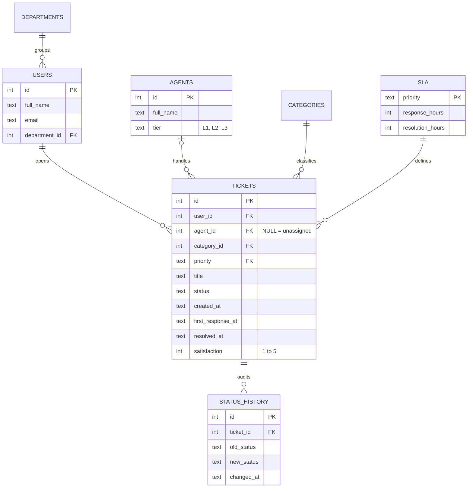

# 🎧 Help Desk Analytics — Support Tickets & SLA in SQL

A database for an IT support team (Help Desk / Service Desk) with users, L1–L3 agents,
categories, priorities and service level agreements (SLAs). The queries answer what a support
lead asks every week: are we meeting the SLA? Which agent resolves tickets fastest? Which issues
keep repeating and should be automated?

All data is **fictional** (500 tickets, 60 users, 6 agents) and generated with a
reproducible script.

## 🧠 SQL skills demonstrated

| Topic | Where |
|---|---|
| Relational design with 7 tables, foreign keys and meaningful `NULL` (unassigned ticket) | `sql/schema.sql` |
| Cross-column `CHECK` (consistent dates) and format validation (`LIKE`) | `sql/schema.sql` |
| **Audit triggers**: every status change is logged in `status_history` | `trg_audit_status` |
| Trigger that fills in data automatically | `trg_resolution_date` |
| View that calculates response times and SLA compliance | `v_tickets_sla` |
| Support KPIs: SLA %, MTTR, CSAT, backlog | `sql/queries.sql` |
| Window functions: `RANK`, `DENSE_RANK`, `LAG`, moving average with `ROWS BETWEEN` | `sql/queries.sql` |
| `LEFT JOIN` + `COALESCE`, `GROUP_CONCAT`, `HAVING` | `current_backlog`, `repeat_users` |
| Automated tests, including trigger tests | `tests/test_database.py` |

## 🗂️ Entity-relationship model



## 📁 Project structure

```
sql-help-desk-tickets/
├── sql/
│   ├── schema.sql      # tables, constraints, indexes and triggers
│   ├── seed.sql        # fictional data
│   ├── views.sql       # response time and SLA view
│   └── queries.sql     # 9 KPI queries
├── scripts/
│   └── generate_data.py
├── tests/
│   └── test_database.py
└── run.py
```

## ▶️ How to run it

You only need **Python 3.8+** (SQLite is built in).

```bash
python run.py                      # builds helpdesk.db and runs every query
python run.py --list               # lists the queries
python run.py agent_performance    # runs a single query
python -m unittest discover tests
```

## 📊 Sample results

**Agent performance** (`RANK() OVER`):

```
agent         | resolved | mttr_hours | sla_pct | csat | sla_rank
--------------+----------+------------+---------+------+---------
Iván Torres   | 113      | 16.0       | 93.8    | 4.21 | 1
Beatriz Soto  | 53       | 19.4       | 86.8    | 3.79 | 2
Tomás Aguilar | 63       | 27.9       | 74.6    | 3.64 | 3
Laura Méndez  | 118      | 22.3       | 71.2    | 3.61 | 4
Rodrigo Leal  | 23       | 27.4       | 56.5    | 3.41 | 5
Karla Ruiz    | 105      | 31.7       | 48.6    | 3.38 | 6
```

**SLA compliance by priority:**

```
priority | sla_hours | resolved | avg_hours | compliance_pct
---------+-----------+----------+-----------+---------------
Critical | 4         | 29       | 3.1       | 72.4
High     | 8         | 98       | 6.7       | 67.3
Medium   | 24        | 220      | 17.0      | 75.9
Low      | 72        | 128      | 52.3      | 72.7
```

**Most repeated issues** (candidates for self-service or automation):

```
title                | occurrences | position
---------------------+-------------+---------
Shared folder access | 57          | 1
Password reset       | 53          | 2
Account locked       | 51          | 3
No internet          | 32          | 4
VPN won't connect    | 30          | 5
```

💡 **Insight:** the top three are all access issues (161 tickets, ~32% of the total).
A self-service password reset portal would significantly reduce the L1 workload.

## 👤 Author

**Jordi Blanch** — Software Engineering student (Hybridge)
