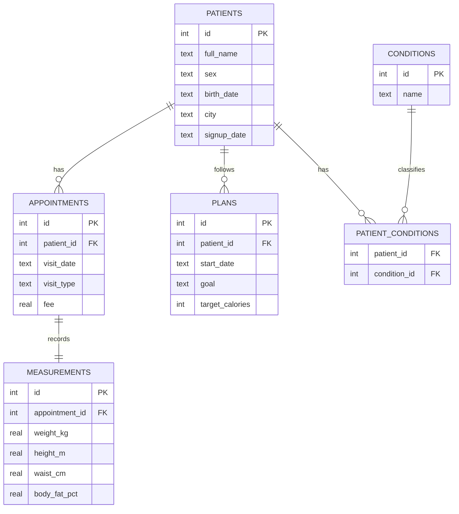

# 🥗 Nutrition Clinic — SQL Database & Analytics

A relational database for a nutrition clinic: patients, appointments, body measurements,
medical conditions and nutrition plans. The analytical queries answer real questions from
a clinic's day-to-day work: who is losing weight, which patients stopped coming, and how much
the clinic bills each month.

The design is based on my experience as a clinical nutritionist (10 years in private practice).
All data is **fictional** and generated with a reproducible script.

## 🧠 SQL skills demonstrated

| Topic | Where |
|---|---|
| Normalized design (3NF), primary and foreign keys, many-to-many relationship | `sql/schema.sql` |
| `CHECK`, `UNIQUE` and `ON DELETE CASCADE` constraints | `sql/schema.sql` |
| Trigger enforcing a business rule | `trg_valid_visit_date` |
| Composite indexes | `idx_appointments_patient_date` |
| Views | `sql/views.sql` |
| `JOIN`, `LEFT JOIN`, `GROUP BY`, `HAVING`, `CASE` | `sql/queries.sql` |
| CTEs (`WITH`) | `top_weight_loss`, `inactive_patients` |
| Window functions: `ROW_NUMBER`, `LAG`, `FIRST_VALUE`, `LAST_VALUE`, `SUM() OVER` | `sql/queries.sql` |
| Date functions (`strftime`, `julianday`) | `monthly_revenue`, `inactive_patients` |
| Automated tests with `unittest` | `tests/test_database.py` |

## 🗂️ Entity-relationship model



## 📁 Project structure

```
sql-nutrition-clinic/
├── sql/
│   ├── schema.sql      # tables, constraints, indexes and trigger
│   ├── seed.sql        # fictional data (40 patients, ~200 appointments)
│   ├── views.sql       # BMI and latest-measurement views
│   └── queries.sql     # 9 analytical queries
├── scripts/
│   └── generate_data.py  # regenerates seed.sql (fixed seed)
├── tests/
│   └── test_database.py  # tests for queries, trigger and constraints
└── run.py                # builds the database and runs the queries
```

## ▶️ How to run it

You only need **Python 3.8+** (SQLite is built in, nothing to install).

```bash
python run.py                    # builds clinic.db and runs every query
python run.py --list             # lists the available queries
python run.py top_weight_loss    # runs a single query
python -m unittest discover tests
```

## 📊 Sample results

**Top 5 patients by weight lost** (CTE + `FIRST_VALUE`/`LAST_VALUE`):

```
patient                | visits | start_weight | latest_weight | loss_pct
-----------------------+--------+--------------+---------------+---------
Emilio Pérez Reyes     | 8      | 62.8         | 51.8          | 17.5
Lucía Martínez Reyes   | 8      | 85.8         | 75.8          | 11.7
Óscar Reyes Ramírez    | 7      | 75.8         | 68.1          | 10.2
Sofía Morales Sánchez  | 5      | 77.5         | 69.7          | 10.1
Sergio Ramírez Jiménez | 7      | 77.4         | 69.7          | 9.9
```

**Patients by BMI class** (percentage with `SUM() OVER ()`):

```
who_class  | patients | percentage
-----------+----------+-----------
Overweight | 13       | 32.5
Obesity I  | 10       | 25.0
Normal     | 9        | 22.5
Obesity II | 8        | 20.0
```

**Results by plan goal:**

```
goal            | patients | avg_change_kg
----------------+----------+--------------
weight loss     | 26       | -5.0
glucose control | 6        | -3.0
maintenance     | 6        | -0.9
muscle gain     | 2        | 1.3
```

## 👤 Author

**Jordi Blanch** — Software Engineering student (Hybridge) · Licensed Nutritionist
