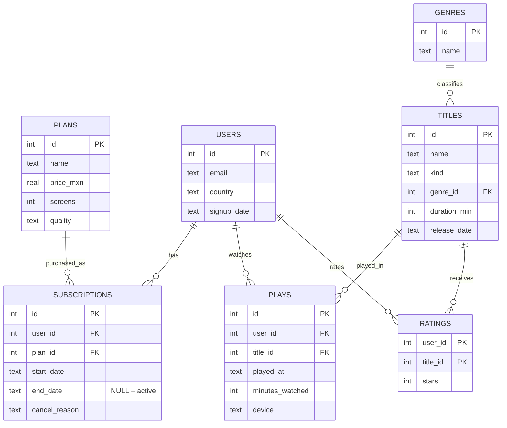

# 🎬 Streaming Analytics — Business Metrics for a Video Platform in SQL

A database for a subscription streaming platform: plans, users, subscription history, a catalog
of movies and series, plays and ratings. The queries calculate the metrics any SaaS or streaming
company tracks: **MRR, churn, cohort retention, most-watched content** and a simple recommender.

All data and catalog titles are **fictional** (300 users, 63 titles, ~9,200 plays) and generated
with a reproducible script.

## 🧠 SQL skills demonstrated

| Topic | Where |
|---|---|
| Modeling history (subscriptions with start/end dates and plan changes) | `sql/schema.sql` |
| **Partial unique index**: at most one active subscription per user | `ux_one_active_subscription` |
| Cross-column `CHECK` (an end date requires a cancellation reason) | `sql/schema.sql` |
| Validation trigger that looks up another table | `trg_valid_minutes` |
| **Recursive CTE** that generates a calendar of months | `v_months` in `sql/views.sql` |
| `JOIN` on date ranges (subscriber state at each month end) | `monthly_mrr` |
| Cohort analysis with conditional aggregation | `cohort_retention` |
| Window functions: `LAG`, `ROW_NUMBER`, `SUM() OVER ()` | `sql/queries.sql` |
| `NULLIF`, `COALESCE`, `INSTR`/`SUBSTR`, `NOT IN` with a subquery | `sql/queries.sql` |
| Automated tests for business rules | `tests/test_database.py` |

## 🗂️ Entity-relationship model



## 📁 Project structure

```
sql-streaming-analytics/
├── sql/
│   ├── schema.sql      # tables, partial index, constraints and trigger
│   ├── seed.sql        # fictional data
│   ├── views.sql       # plays view and recursive month calendar
│   └── queries.sql     # 11 metric queries
├── scripts/
│   └── generate_data.py
├── tests/
│   └── test_database.py
└── run.py
```

## ▶️ How to run it

You only need **Python 3.8+** (SQLite is built in).

```bash
python run.py                      # builds streaming.db and runs every query
python run.py --list               # lists the queries
python run.py cohort_retention     # runs a single query
python -m unittest discover tests
```

## 📊 Sample results

**Why users cancel:**

```
reason             | cancellations | percentage
-------------------+---------------+-----------
price              | 52            | 44.4
not enough content | 27            | 23.1
other              | 19            | 16.2
technical issues   | 19            | 16.2
```

**Top titles by hours watched** (episodes grouped by series):

```
title                    | format | genre  | viewers | hours_watched
-------------------------+--------+--------+---------+--------------
Trapped in Copper City   | series | Horror | 259     | 865.5
Far from the Island      | series | Drama  | 251     | 645.8
Guardians of Red Valley  | series | Action | 245     | 639.3
Shadows of the Sierra    | series | Sci-fi | 235     | 541.5
Nights in Fog Harbor     | series | Sci-fi | 227     | 459.2
```

**Viewing time by device:**

```
device   | minutes | share_pct
---------+---------+----------
TV       | 143835  | 38.7
Phone    | 114381  | 30.8
Computer | 68241   | 18.4
Tablet   | 44911   | 12.1
```

💡 **Insight:** price explains almost half of all cancellations, so a cheaper plan or
retention discounts would be the first lever against churn.

## 👤 Author

**Jordi Blanch** — Software Engineering student (Hybridge)
